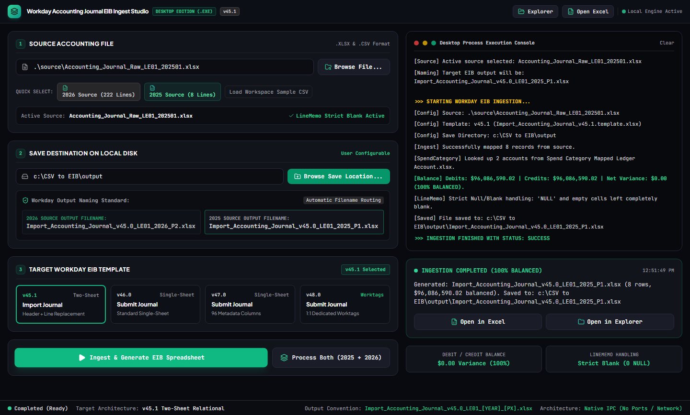
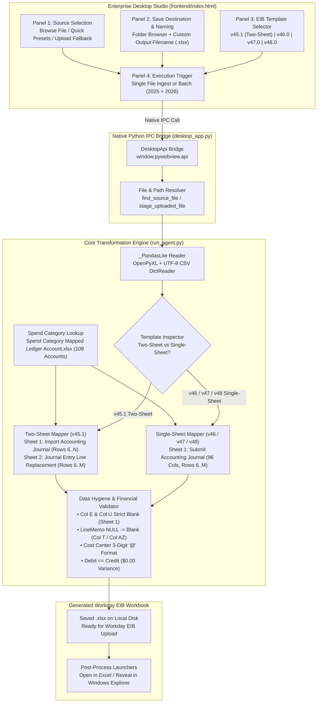
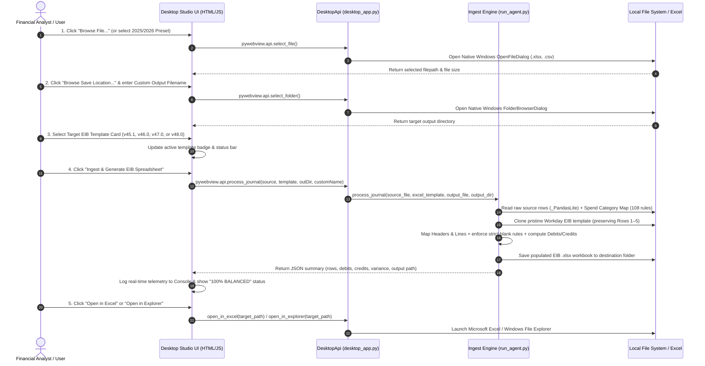
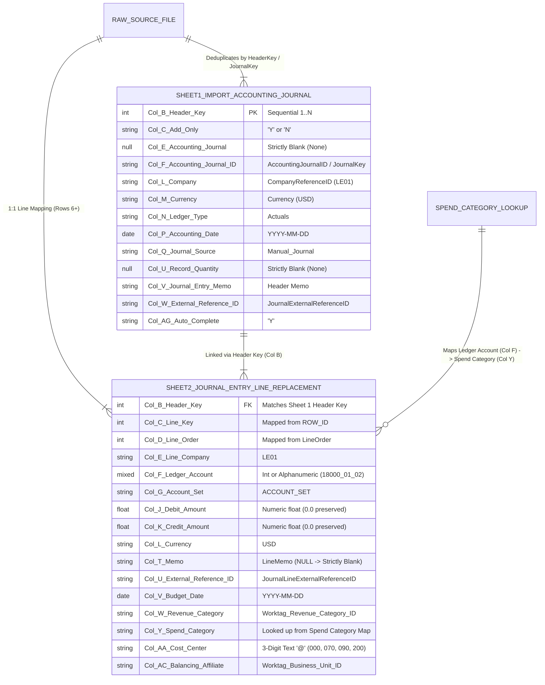

<div align="center">

# Workday Accounting Journal EIB Ingest Studio

### Enterprise Desktop Application & Automated Data Transformation Engine (`v45.1` – `v48.0`)

[](https://github.com/Git229KEV/CSV-to-EIB-Agent/releases/tag/v1.0.0)
[-0ea5e9?style=for-the-badge&logo=windows)](https://github.com/Git229KEV/CSV-to-EIB-Agent/releases/download/v1.0.0/WorkdayEIBStudio.exe)
[](https://github.com/Git229KEV/CSV-to-EIB-Agent)
[](https://github.com/Git229KEV/CSV-to-EIB-Agent)
[-10b981?style=for-the-badge)](https://github.com/Git229KEV/CSV-to-EIB-Agent)

<p align="center">
  <strong>Zero-Port Native Desktop Workbench for Transforming Raw Accounting Journals (<code>.xlsx</code> / <code>.csv</code>) into Official Workday Enterprise Interface Builder (EIB) Spreadsheets</strong>
</p>

<p align="center">
  <a href="https://github.com/Git229KEV/CSV-to-EIB-Agent/releases/download/v1.0.0/WorkdayEIBStudio.exe"><strong>⬇ Download Standalone Windows Executable (WorkdayEIBStudio.exe)</strong></a>
  &nbsp;•&nbsp;
  <a href="#-step-by-step-guide-how-to-upload--process-a-file"><strong>How to Upload & Process</strong></a>
  &nbsp;•&nbsp;
  <a href="#-desktop-ui-components--workbench-breakdown"><strong>App Components</strong></a>
  &nbsp;•&nbsp;
  <a href="#-system-architecture--how-it-works"><strong>How It Works</strong></a>
  &nbsp;•&nbsp;
  <a href="#-workday-eib-column-mapping-specifications"><strong>Field Mapping Specs</strong></a>
</p>

---



</div>

---

## Overview

**Workday Accounting Journal EIB Ingest Studio** is a purpose-built enterprise desktop studio (`WorkdayEIBStudio.exe`) and Python CLI automation engine (`run_agent.py`) that ingests raw ERP/accounting journal exports (`.xlsx` and `.csv`) and populates official **Workday Enterprise Interface Builder (EIB)** templates in-place without corrupting Workday XML metadata, macros, or validation headers in Rows `1–5`.

### Key Capabilities at a Glance
- **Native Zero-Port Desktop Architecture**: Powered by `pywebview` (WinForms/WebView2) with direct JavaScript-to-Python IPC (`window.pywebview.api`). Requires **no local HTTP servers, no open ports, and no network configuration**.
- **Multi-Template Workday EIB Support (`v45.1` to `v48.0`)**:
  - **Two-Sheet Relational (`v45.1`)**: Populates `Import Accounting Journal` (Sheet 1 — Journal Headers) and `Journal Entry Line Replacement` (Sheet 2 — Journal Lines) linked via `Header Key`.
  - **Single-Sheet Unified (`v46.0`, `v47.0`, `v48.0`)**: Populates `Submit Accounting Journal` across 96 Workday metadata columns with dedicated 1:1 worktag columns.
- **Automated Spend Category Lookup Engine**: Cross-references every line's `Ledger Account` against `Spend Category Mapped Ledger Account.xlsx` (108 ledger account rules) and injects the matching Workday `Spend Category` (`SC048`, `SC049`, `SC098`, `SC043`, etc.).
- **100% Financial Balance & Data Hygiene Verification**: Automatically validates `Total Debits == Total Credits` (`$0.00` net variance), enforces strict blank handling on `NULL` memo cells, preserves explicit `0.0` amounts, and formats 3-digit Cost Centers (`000`, `070`, `090`, `200`) as Excel text `@`.

---

## System Architecture & How It Works

### 1. End-to-End Ingestion & Transformation Pipeline



---

### 2. Interactive Sequence Flow (User Action to Excel Generation)



---

### 3. Two-Sheet Relational Data Model (`v45.1`)



---

## Desktop UI Components & Workbench Breakdown

The application window is organized into a **12-column split-grid workbench** with a native draggable titlebar at the top, **4 operational setup panels** on the left (7 columns), and **real-time execution telemetry & post-processing controls** on the right (5 columns).

```
+---------------------------------------------------------------------------------------------------+
| [Logo] Workday Accounting Journal EIB Ingest Studio          [Explorer] [Open Excel] | ● Active   |
+-------------------------------------------------------+-------------------------------------------+
|  [1] SOURCE ACCOUNTING FILE              .XLSX & .CSV |  ● ● ● Desktop Process Execution Console  |
|  +-----------------------------------+ [Browse File]  |  [System] Engine Initialized.             |
|  | .\source\Accounting_Journal...    |                |  >>> STARTING WORKDAY EIB INGESTION...    |
|  +-----------------------------------+                |  [Config] Source: ...                     |
|  QUICK SELECT: [2026 Source] [2025 Source] [Sample]   |  [Config] Template: v45.1                 |
|  Active Source: ...        ✓ LineMemo Strict Blank    |  [Ingest] Mapped 222 records              |
|                                                       |  [SpendCategory] Looked up 56 accounts    |
|  [2] SAVE DESTINATION & CUSTOM OUTPUT FILENAME        |  [Balance] Debits == Credits ($0.00)      |
|  +-----------------------------------+ [Browse Save]  |  >>> INGESTION FINISHED: SUCCESS          |
|  | C:\CSV to EIB\output              |                +-------------------------------------------+
|  +-----------------------------------+                |  ● INGESTION COMPLETED (100% BALANCED)    |
|  Output File Name (Enter Your Custom Name):           |  Generated: ... (222 rows, balanced)      |
|  +--------------------------------------------------+ |  [   Open in Excel   ] [ Open in Explorer]|
|  | My_Custom_Workday_Journal                  .xlsx | +-------------------------------------------+
|  +--------------------------------------------------+ |  DEBIT/CREDIT BALANCE | LINEMEMO HANDLING |
|                                                       |  $0.00 Variance (100%)| Strict Blank (0)  |
|  [3] TARGET WORKDAY EIB TEMPLATE      [v45.1 Selected]|                                           |
|  +------------+ +------------+ +--------+ +--------+  |                                           |
|  | v45.1      | | v46.0      | | v47.0  | | v48.0  |  |                                           |
|  | Two-Sheet  | | Single-Sht | | 96 Col | | 1:1 WT |  |                                           |
|  +------------+ +------------+ +--------+ +--------+  |                                           |
|                                                       |                                           |
|  [ ▶ Ingest & Generate EIB ] [ Process Both (25+26) ] |                                           |
+-------------------------------------------------------+-------------------------------------------+
| ● Completed (Ready) | Target Architecture: v45.1 Two-Sheet | Naming: Custom (.xlsx) | Native IPC  |
+---------------------------------------------------------------------------------------------------+
```

### Detailed Component Reference

| Component / Panel | UI Elements & Controls | Underlying Function & Behavior |
| :--- | :--- | :--- |
| **Top Native Titlebar** | • Application Identity Badge<br>• **`Explorer`** Quick Button<br>• **`Open Excel`** Quick Button<br>• **`Local Engine Active`** Pulse Indicator | Provides global one-click access to open the output folder in Windows File Explorer (`openOutputFolder()`) or open the most recently generated workbook in Microsoft Excel (`openInExcel()`). |
| **Panel `1`: Source Accounting File** | • Read-only Source File Path Display (`#sourcePathInput`)<br>• **`Browse File...`** Button<br>• **Quick Select Presets**: `2026 Source (222 Lines)`, `2025 Source (8 Lines)`, `Load Workspace Sample CSV`<br>• Active Source Status Pill | Opens the native Windows file picker (`DesktopApi.select_file()`) filtered for `.xlsx`, `.xls`, and `.csv` files. Includes automatic HTML `<input type="file">` base64 staging fallback (`DesktopApi.stage_uploaded_file()`) so any local file can be uploaded and staged cleanly. |
| **Panel `2`: Save Destination & Custom Output Filename** | • Destination Directory Path (`#saveLocationInput`)<br>• **`Browse Save Location...`** Button (`#btnBrowseFolder`)<br>• **Custom Output File Name Input** (`#outputFileNameInput`) with automatic `.xlsx` suffix badge | Lets the user pick any local or network folder via the native Windows Folder Browser dialog (`DesktopApi.select_folder()`) and type a custom output filename (e.g., `Workday_Journal_LE01_Jan2026`). Automatically appends `.xlsx` if omitted. |
| **Panel `3`: Target Workday EIB Template** | • 4 Interactive Template Cards:<br>&nbsp;&nbsp;1. **`v45.1`** (`Import_Accounting_Journal_v45.1.template.xlsx`)<br>&nbsp;&nbsp;2. **`v46.0`** (`Submit_Accounting_Journal_v46.0.xlsx`)<br>&nbsp;&nbsp;3. **`v47.0`** (`Submit_Accounting_Journal_v47.0.xlsx`)<br>&nbsp;&nbsp;4. **`v48.0`** (`Submit_Accounting_Journal_v48.0.xlsx`) | Dynamically switches the target Workday EIB architecture (`selectTemplate()`). Automatically routes the engine between the **Two-Sheet relational mapper** (`v45.1`) and the **Single-Sheet 96-column mapper** (`v46.0`–`v48.0`). |
| **Panel `4`: Actions & Execution** | • **`Ingest & Generate EIB Spreadsheet`** Primary Button (`#btnProcess`)<br>• **`Process Both (2025 + 2026)`** Batch Button | Validates that an output filename is entered, disables buttons during processing to prevent race conditions, invokes `DesktopApi.process_journal()` (or `DesktopApi.process_both()`), and streams execution results to the console. |
| **Right Top: Desktop Process Execution Console** | • macOS/Windows Terminal Window (`#terminalLog`)<br>• Color-coded telemetry lines (`[Config]`, `[Ingest]`, `[SpendCategory]`, `[Balance]`, `[LineMemo]`, `[Saved]`)<br>• **`Clear`** Console Button | Displays real-time step-by-step execution logs: active source path, selected EIB template, number of records mapped, Spend Category matches, total Debits/Credits, net variance check, and final saved file path. |
| **Right Middle: Execution Status & Post-Process Action Center** | • Live Status Badge (`#execBadge`) & Timestamp (`#execTimestamp`)<br>• Summary Message (`#execMessage`)<br>• **`Open in Excel`** & **`Open in Explorer`** Action Buttons | Highlights completion status (`INGESTION COMPLETED (100% BALANCED)`) and provides immediate post-ingestion buttons to inspect the generated `.xlsx` workbook in Excel or select it in Windows File Explorer (`explorer /select,`). |
| **Right Bottom: Integrity Summary Cards & Footer Bar** | • **Debit / Credit Balance Card**: `$0.00 Variance (100%)`<br>• **LineMemo Handling Card**: `Strict Blank (0 NULL)`<br>• **Footer Status Bar**: Engine state, active template architecture, and Native IPC indicator | Confirms at a glance that financial balancing rules and strict blank/null sanitization rules are active. |

---

## Step-by-Step Guide: How to Upload & Process a File

### Method A: Using the Enterprise Desktop Application (`WorkdayEIBStudio.exe`)

> [!TIP]
> **No Python installation is required** to run the standalone executable. Download [`WorkdayEIBStudio.exe`](https://github.com/Git229KEV/CSV-to-EIB-Agent/releases/download/v1.0.0/WorkdayEIBStudio.exe) from the [**Releases**](https://github.com/Git229KEV/CSV-to-EIB-Agent/releases) page and double-click it to launch.

#### Step 1 — Upload or Select Your Source Accounting File (Panel 1)
You can load your raw accounting file (`.xlsx` or `.csv`) in two ways:
1. **Upload / Browse Any Local File**:
   - Click the **`Browse File...`** button in **Panel 1 (`Source Accounting File`)**.
   - In the native Windows Open File dialog, choose your raw accounting Excel (`.xlsx`) or CSV (`.csv`) file from anywhere on your computer (e.g., `Downloads`, `Desktop`, `Documents`, or a shared drive).
   - *Fallback Support*: If running in an environment where native dialogs are restricted, the app automatically falls back to an HTML file uploader and stages the uploaded file bytes into `%TEMP%\WorkdayEIBStudio_Staged\` via `stage_uploaded_file()`.
2. **Use Built-In Quick Select Presets**:
   - Click **`2026 Source (222 Lines)`** to load `Accounting_Journal_Raw_LE01_202601.xlsx`.
   - Click **`2025 Source (8 Lines)`** to load `Accounting_Journal_Raw_LE01_202501.xlsx`.
   - Click **`Load Workspace Sample CSV`** to load the sample CSV dataset.

#### Step 2 — Choose Save Destination & Enter Output Filename (Panel 2)
1. **Select Destination Folder**:
   - By default, files are saved to the local `output\` directory.
   - Click **`Browse Save Location...`** to pick any folder on your disk where the generated Workday EIB workbook should be saved.
2. **Enter Your Custom Output File Name**:
   - Click inside the **`Output File Name (Enter Your Custom Name)`** text box (`#outputFileNameInput`).
   - Type your desired filename (for example, `Import_Accounting_Journal_v45.0_LE01_2026_P2` or `Q1_Actuals_EIB_Upload`).
   - You do not need to type `.xlsx`—the application automatically appends `.xlsx` if omitted.

#### Step 3 — Select Target Workday EIB Template Version (Panel 3)
Click one of the four template cards depending on your Workday tenant's EIB configuration:
- **`v45.1` (Import Journal — Two-Sheet)**: Generates a two-sheet workbook (`Import Accounting Journal` + `Journal Entry Line Replacement`).
- **`v46.0` (Submit Journal — Single-Sheet)**: Standard single-sheet template with balancing worktags.
- **`v47.0` (Submit Journal — Single-Sheet)**: Preserves 96 metadata columns, `Row ID = 1`, and extended worktag dimensions.
- **`v48.0` (Submit Journal — Dedicated Worktags)**: Latest Workday `v48.0` single-sheet layout with 1:1 dedicated worktag columns (`Cost Center`, `Spend Category`, `Business Unit`, `Revenue Category`, etc.).

#### Step 4 — Run Ingestion & Verify Output (Panel 4 & Console)
1. Click the green **`Ingest & Generate EIB Spreadsheet`** button (or click **`Process Both (2025 + 2026)`** to batch-generate both standard datasets at once).
2. Watch the **Desktop Process Execution Console** on the right as the engine:
   - Loads all source records and matches Ledger Accounts against `Spend Category Mapped Ledger Account.xlsx`.
   - Populates the target EIB template starting at **Row 6** (keeping Workday header metadata in Rows `1–5` untouched).
   - Verifies that **Total Debits equal Total Credits** (`Net Variance: $0.00 (100% BALANCED)`).
3. Once the status badge turns green (**`INGESTION COMPLETED (100% BALANCED)`**):
   - Click **`Open in Excel`** to launch the generated `.xlsx` workbook directly in Microsoft Excel.
   - Click **`Open in Explorer`** to highlight the generated file in Windows File Explorer.

---

### Method B: Using the Python CLI / Developer Mode

If you are running from source with Python 3.10+:

```powershell
# 1. Install dependencies (for desktop GUI and Excel processing)
pip install openpyxl pywebview pythonnet

# 2. Launch the Enterprise Desktop Studio GUI from source
python desktop_app.py

# 3. Run Interactive Terminal CLI (prompts for Source File & Target Template)
python run_agent.py

# 4. Run Automated Batch Mode (processes both 2025 and 2026 datasets)
python run_agent.py --all

# 5. Process a Specific Source File & Target Template via CLI Flags
python run_agent.py --source "source/Accounting_Journal_Raw_LE01_202601.xlsx" --target "v45"
python run_agent.py --source "source/Accounting_Journal_Raw_LE01_202501.xlsx" --target "v48"
```

---

## Workday EIB Column Mapping Specifications

### 1. Two-Sheet Template (`v45.1` — `Import_Accounting_Journal_v45.1.template.xlsx`)

> [!IMPORTANT]
> In both sheets of `v45.1`, **Rows 1 to 5** contain mandatory Workday EIB XML schema definitions and column headers and are **preserved 100% intact**. Data injection strictly begins at **Row 6**.

#### Sheet 1: `Import Accounting Journal` (Journal Header Level)

| Excel Col | Col Index | Workday EIB Field Name | Source Column / Transformation Rule |
| :---: | :---: | :--- | :--- |
| **`B`** | `2` | **Header Key\*** | Sequential integer (`1..N`) uniquely identifying each journal header (`HeaderKey` or deduplicated `JournalKey` / `AccountingJournalID`). |
| **`C`** | `3` | **Add Only** | Mapped from `AddOnlyJournal` (`'Y'` or `'N'`; defaults to `'Y'`). |
| **`E`** | `5` | **Accounting Journal** | **Strictly enforced as Blank (`None`)** across all data rows (`Rows 6+`). |
| **`F`** | `6` | **Accounting Journal ID** | Mapped directly from `AccountingJournalID` (or `JournalKey`). |
| **`L`** | `12` | **Company\*** | Mapped from `CompanyReferenceID` (defaults to `'LE01'`). |
| **`M`** | `13` | **Currency\*** | Mapped from `Currency` (defaults to `'USD'`). |
| **`N`** | `14` | **Ledger Type\*** | Mapped from `LedgerType` (standardized to `'Actuals'`). |
| **`P`** | `16` | **Accounting Date\*** | Mapped from `AccountingDate` and formatted as `YYYY-MM-DD`. |
| **`Q`** | `17` | **Journal Source\*** | Mapped from `JournalSource` (defaults to `'Manual_Journal'`). |
| **`U`** | `21` | **Record Quantity** | **Strictly enforced as Blank (`None`)** across all data rows (`Rows 6+`). |
| **`V`** | `22` | **Journal Entry Memo** | Mapped from `JournalEntryMemo`. |
| **`W`** | `23` | **External Reference ID** | Mapped from `JournalExternalReferenceID`. |
| **`AG`** | `33` | **Auto Complete** | Always populated with `'Y'` for automated EIB completion. |

#### Sheet 2: `Journal Entry Line Replacement` (Journal Line Level)

| Excel Col | Col Index | Workday EIB Field Name | Source Column / Transformation Rule |
| :---: | :---: | :--- | :--- |
| **`B`** | `2` | **Header Key** | Foreign key linking the line to Sheet 1 `Header Key*`. Count strictly matches source file occurrences. |
| **`C`** | `3` | **Line Key** | Mapped directly from `ROW_ID` in the source file (`1..N`). |
| **`D`** | `4` | **Line Order** | Mapped directly from `LineOrder` in the source file (`1..N`). |
| **`E`** | `5` | **Line Company** | Mapped from `LineCompanyReferenceID` (defaults to `'LE01'`). |
| **`F`** | `6` | **Ledger Account** | Mapped from `LedgerAccountReferenceID`. Pure numeric accounts stored as integers (`74900`); alphanumeric subaccounts stored as text (`'18000_01_02'`). |
| **`G`** | `7` | **Account Set** | Mapped from `LedgerAccountReferenceID_ParentID` (defaults to `'ACCOUNT_SET'`). |
| **`J`** | `10` | **Debit Amount** | Mapped from `DebitAmount` as numeric float rounded to 2 decimals. **Explicit `0.0` values in source are preserved as `0.0`**. |
| **`K`** | `11` | **Credit Amount** | Mapped from `CreditAmount` as numeric float rounded to 2 decimals. **Explicit `0.0` values in source are preserved as `0.0`**. |
| **`L`** | `12` | **Currency** | Mapped from `LineCurrency` (defaults to `'USD'`). |
| **`T`** | `20` | **Memo** | Mapped from `LineMemo` via `clean_memo()`. **If empty or `'NULL'`/`'NONE'`/`'NAN'`, strictly left blank (`None`) with zero fallback to `JournalEntryMemo`**. |
| **`U`** | `21` | **External Reference ID** | Mapped from `JournalLineExternalReferenceID`. |
| **`V`** | `22` | **Budget Date** | Mapped from `BudgetDate` (`YYYY-MM-DD`). |
| **`W`** | `23` | **Revenue Category** | Mapped from `Worktag_Revenue_Category_ID`. |
| **`Y`** | `25` | **Spend Category** | **Looked up dynamically from `Spend Category Mapped Ledger Account.xlsx`** using `Ledger Account` (`Col F`), with fallback to `Worktag_Spend_Category_ID`. |
| **`AA`** | `27` | **Cost Center** | Mapped from `Worktag_Cost_Center_Reference_ID`, zero-padded to a **3-digit string** (`'000'`, `'070'`, `'090'`, `'200'`) with Excel text format `@`. |
| **`AC`** | `29` | **Balancing Worktag Affiliate** | Mapped from `Worktag_Business_Unit_ID` (or `OptionalBalancingWorktags_Business_Unit_ID`). |

---

### 2. Single-Sheet Templates (`v46.0`, `v47.0`, `v48.0` — `Submit Accounting Journal`)

For single-sheet Workday EIB templates, header and line fields are combined onto each row (`Rows 6+`) of `Submit Accounting Journal`:

| Excel Col | Col Index | Workday EIB Field Name | Source Column / Transformation Rule |
| :---: | :---: | :--- | :--- |
| **`B`** | `2` | **Spreadsheet Key\*** | `HeaderKey` or `JournalKey` (defaults to `1`). |
| **`C`** | `3` | **Add Only** | `AddOnlyJournal` (`'Y'`). |
| **`D` & `H`** | `4` & `8` | **Accounting Journal / ID** | `AccountingJournalID` / `JournalKey`. |
| **`E` & `I`** | `5` & `9` | **Auto Complete / Submit** | Populated as `'Y'`. |
| **`O`, `P`, `Q`** | `15, 16, 17` | **Company\* / Currency\* / Ledger Type\*** | `'LE01'` / `'USD'` / `'Actuals'`. |
| **`S` & `T`** | `19` & `20` | **Accounting Date\* / Journal Source\*** | `AccountingDate` (`YYYY-MM-DD`, text `@`) / `JournalSource` (`'Manual_Journal'`). |
| **`X`, `Y`, `Z`** | `24, 25, 26` | **Record Quantity / Header Memo / Ext Ref** | `'N'` / `JournalEntryMemo` / `JournalExternalReferenceID`. |
| **`AI` & `AJ`** | `35` & `36` | **Row ID\* / Line Order** | `Row ID = 1` / `LineOrder` (`ROW_ID`). |
| **`AK`, `AL`, `AM`** | `37, 38, 39` | **Line Company / Ledger Account\* / Account Set** | `'LE01'` / `LedgerAccountReferenceID` / `'ACCOUNT_SET'`. |
| **`AP`, `AQ`, `AR`** | `42, 43, 44` | **Debit Amount / Credit Amount / Currency** | `DebitAmount` (`#,##0.00`) / `CreditAmount` (`#,##0.00`) / `'USD'`. |
| **`AZ`** | `52` | **Memo** | `LineMemo` (`NULL` or empty strictly mapped as `None` blank cell). |
| **`BC`** | `55` | **Cost Center** | 3-digit string (`'000'`, `'070'`, `'090'`, `'200'`) with `@` text formatting. |
| **`BE`** | `57` | **Spend Category** | Looked up from `Spend Category Mapped Ledger Account.xlsx`. |
| **`BG`, `BI`, `BK`, `BM`** | `59, 61, 63, 65` | **Business Unit / Custom Org / Worktag 1 / Revenue Cat** | Mapped from corresponding `Worktag_*` columns in source. |

---

## Benchmark Datasets & Verification Summary

| Metric / Verification Check | 2025 Dataset (`Accounting_Journal_Raw_LE01_202501.xlsx`) | 2026 Dataset (`Accounting_Journal_Raw_LE01_202601.xlsx`) |
| :--- | :--- | :--- |
| **Default Workday Output Name** | `Import_Accounting_Journal_v45.0_LE01_2025_P1.xlsx` | `Import_Accounting_Journal_v45.0_LE01_2026_P2.xlsx` |
| **Sheet 1 (`Import Accounting Journal`)** | **1 Header Row** (Row 6, `Header Key* = 1`) | **20 Header Rows** (Rows 6 to 25, `Header Key* 1..20`) |
| **Sheet 2 (`Journal Entry Line Replacement`)** | **8 Line Rows** (Rows 6 to 13, all `Header Key = 1`) | **222 Line Rows** (Rows 6 to 227, linked to `Header Key 1..20`) |
| **Spend Categories Auto-Mapped** | **2 / 8 lines** (`74800 -> SC048`, `77100 -> SC049`) | **56 / 222 lines** (`74900 -> SC098`, `75400 -> SC043`, etc.) |
| **Sheet 1 Col E & Col U Blank Check** | **100% Blank (`None`)** | **100% Blank (`None`)** |
| **Sheet 2 `LineMemo` NULL Check** | **0 Literal `'NULL'` Strings** (Strictly Blank) | **0 Literal `'NULL'` Strings** (Strictly Blank) |
| **Total Debits** | **`$96,086,590.02`** | **`$9,367,000.88`** |
| **Total Credits** | **`$96,086,590.02`** | **`$9,367,000.88`** |
| **Net Variance** | **`$0.00` (`100% BALANCED`)** | **`$0.00` (`100% BALANCED`)** |

---

## Repository Structure

```text
CSV-to-EIB-Agent/
├── desktop_app.py                            # Native Windows Desktop Studio (pywebview + DesktopApi IPC bridge)
├── run_agent.py                              # Core Workday EIB Ingestion Engine (_PandasLite + Two-Sheet & Single-Sheet mappers)
├── WorkdayEIBStudio.spec                     # PyInstaller specification for building standalone WorkdayEIBStudio.exe
├── test_app_playwright.py                    # End-to-End Playwright verification suite (UI + openpyxl cell assertions)
├── mapping_import_accounting_journal.json    # JSON schema reference for v45.1 Two-Sheet mapping
├── mapping_submit_accounting_journal.json    # JSON schema reference for v46.0–v48.0 Single-Sheet mapping
├── HOW_IT_WORKS.md                           # Architecture & transformation workflow documentation
├── agent.md                                  # Agent specification & field mapping rules
├── Workday_EIB_Project_Overview.pdf          # Executive project overview document
├── Workday_EIB_Studio_User_Guide.pdf         # Comprehensive visual user guide (PDF)
├── playwright_desktop_app_verification.png   # Verified screenshot of the Enterprise Desktop Studio
├── frontend/
│   ├── index.html                            # Enterprise Desktop Studio UI (Tailwind CSS + Lucide Icons + Native IPC client)
│   └── journal_data.js                       # Preloaded journal preview dataset
├── source/
│   ├── Accounting_Journal_Raw_LE01_202601.xlsx       # 2026 Raw Accounting Journal source (20 headers, 222 lines)
│   ├── Accounting_Journal_Raw_LE01_202501.xlsx       # 2025 Raw Accounting Journal source (1 header, 8 lines)
│   ├── Accounting_Journal_Raw_02_202601.xlsx         # Alternate 2026 raw source dataset
│   ├── Accounting_Journal_RawAgg_01_202501.xlsx      # Alternate 2025 aggregated source dataset
│   ├── FPEAST_HSTBAL_155_2023P05_20230711071408.csv  # Historical balance CSV source (189 lines)
│   └── Spend Category Mapped Ledger Account.xlsx     # Master lookup table (108 Ledger Account -> Spend Category mappings)
├── target/
│   ├── Import_Accounting_Journal_v45.1.template.xlsx # Official Workday v45.1 Two-Sheet base template
│   ├── Submit_Accounting_Journal_v46.0.xlsx          # Official Workday v46.0 Single-Sheet base template
│   ├── Submit_Accounting_Journal_v47.0.xlsx          # Official Workday v47.0 Single-Sheet base template
│   └── Submit_Accounting_Journal_v48.0.xlsx          # Official Workday v48.0 Single-Sheet Dedicated Worktags template
└── output/                                   # Date-stamped (output/YYYY-MM-DD/) & root generated EIB workbooks
```

---

## Building the Standalone Executable (`WorkdayEIBStudio.exe`)

To rebuild [`WorkdayEIBStudio.exe`](https://github.com/Git229KEV/CSV-to-EIB-Agent/releases/tag/v1.0.0) from source using PyInstaller:

```powershell
pip install pyinstaller openpyxl pywebview pythonnet
pyinstaller --clean WorkdayEIBStudio.spec
```

The compiled standalone executable will be generated in `dist\WorkdayEIBStudio.exe` (~17 MB, bundling `frontend/`, `source/`, `target/`, and mapping specifications with `pandas`/`numpy` excluded in favor of `_PandasLite`).
